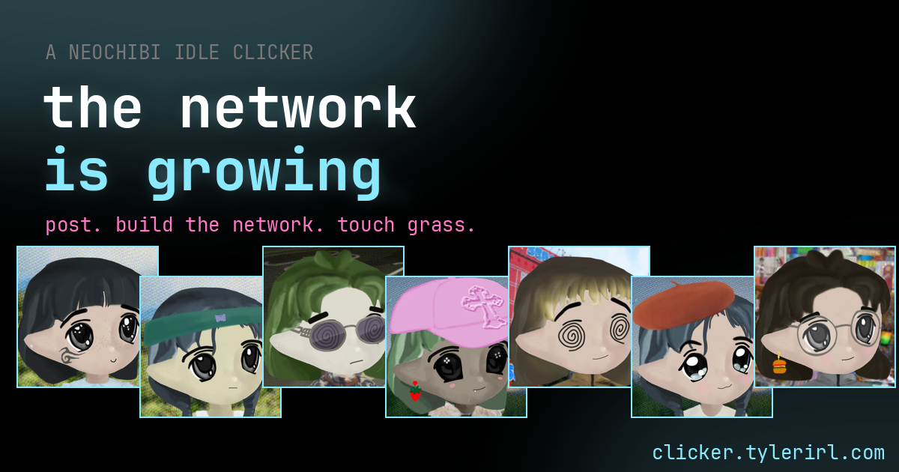

# the network is growing_

A neochibi idle clicker. Post. Build the network. Touch grass.

**Play it: [clicker.tylerirl.com](https://clicker.tylerirl.com)**



You start alone, posting. Click your Milady and she posts, and posting makes vibes. Turn vibes into memes, build a group chat out of them, and someone shows up. Then someone else. Before long it's a network, and a network needs feeding.

## How it plays

- **Post.** Click yourself (or press space). That's the clicker part, and early on it's the whole game.
- **Miladys.** Build somewhere for them to live (group chats, discord servers, milady houses) and they turn up on their own. Every one is generated from the official trait layers, so the network looks like a network. Each eats half a vibe a second. If the vibes run out they log off.
- **Jobs.** New arrivals sit idle until you put them to work: posters make vibes, memers make memes, lorekeepers make lore, traders make $CULT, artists make drip, streamers make clout, and mods keep everyone happy. Click any of them in the gallery to see her, rename her, or move her.
- **Happiness.** A crowd gets crabby. Past ten miladys, each new one costs a little happiness, and happiness scales everything they make. Shrines, mods and a few upgrades bring it back.
- **Lore.** Research opens up the rest: new jobs, new buildings, more storage, eventually the infinite garden. There are 39 things to research in all, 35 upgrades, 26 buildings and 10 jobs, though not all at once.
- **Storage.** Every resource has a cap. A price you can't fit says *needs more storage*.
- **The market.** It goes round: accumulation, mania, distribution, bear. Two minutes each, and each is good for something.
- **Sparkles.** 💎 shows up now and then. Catch it for a windfall, a posting frenzy, a glow, or a stranger who followed it in. Drama shows up too, unless you have mods.
- **Touch grass.** Once you've researched the infinite garden, you can log off: everything goes, and you come back with grass. Grass you hold makes everything 3% faster, forever, or you can spend it on perks that stick.
- **Every reset opens a layer.** The first time you touch grass: **the stack**, with compute, devs, data centers, and agents that put new Miladys straight to work. The second: **network spirituality**, with devotion, acolytes, and rituals (summon the bull, an airdrop, a vigil), and **Remilios** start joining the network. The third: **raids**, sending Miladys out to the replies, a rival discord, crypto twitter, the timeline, or the cancel itself, for loot and 24 **relics** you keep forever and level up. The fourth: **the cathedral**, ten stages tall, built from ether. The fifth: **challenges**, runs with a rule bent (no posting, a bear market all run, a small world, no upgrades, a speedrun) for rewards that last. The sixth: **the new internet**.
- **Robots.** Later perks buy automation: a meme machine, grad students who research, a personal shopper for upgrades, and scripts that build out of whatever's spare (keeping back a reserve you choose, and skipping any building you tell them to). Each has an off switch on the network tab.
- **The ending.** The new internet is seven stages (the protocol, the nodes, the mesh, the handshake, the namespace, the archive, and the new internet itself), each filled by pouring resources in: a share of what you make, and everything that would overflow. What goes in stays when you touch grass, every stage is a bonus for good, and the last one needs the cathedral standing. Turn it on and the network gathers into a globe, the story of it plays, and then you can keep posting.

It saves itself in your browser and keeps going while you're away (8 hours, or 24 with a perk).

## Accounts and leaderboards

Sign in with **RemiliaNET** or **Urbit ID** (the same sign-in as [the cancel is coming](https://cancel.tylerirl.com), on the same service) and your network lives on your account: open it on a laptop, a desktop and a phone and it's the same one. It's sent up every minute and whenever you switch away, and each device keeps a copy so it opens straight away and plays on without a connection. If another device saved since, that one wins and this one picks up from it. The first time an account signs in, the network already in that browser moves onto it; signing out puts the browser back to its own.

Signed-in players are on the **boards**: fastest run to the infinite garden (challenges don't count), most grass earned, biggest network, and who turned on the new internet first.

Saves can't be downloaded, pasted or loaded from a file any more, since that would let anyone put anything on the boards. The game runs in the browser, so nothing is proven, but the service holds every save against the last one it accepted: time played can't outrun the clock, counters only go up, runs have to take a plausible while and make plausible grass, and grass can't be spent that wasn't earned. A save that doesn't add up is refused and the device goes back to the last good one. Only runs started after an account was linked count on the boards.

It installs as an app (or add it to your home screen) and plays offline: the page and code are kept by a service worker, and settings can keep every trait picture (about 11 MB) so new Miladys look right with no connection. An installed copy keeps them on its own. Notifications are off until you turn them on, and then only arrive while the game's in a background tab: a raid home, a ritual ready, storage full, grass to touch, a stage of the new internet done.

## Controls

Mouse and touch do everything. On a phone, once your Milady scrolls out of view she floats in the corner so you can keep posting, and the tabs swipe sideways.

The keyboard does everything too: arrow keys move a highlight over whatever's on screen, Enter presses it (shift+Enter does ten), Space posts, M makes a meme, Q / E or 1-9 change tabs, Esc backs out. A gamepad works the same way: d-pad or stick moves, Ⓐ presses, Ⓑ backs out, Ⓧ posts, Ⓨ makes a meme, LB / RB change tabs, START opens settings.

Numbers can be written short (1.23M), scientific (1.23e6), engineering (45.6e6) or in words (1.23 million), in settings.

Hover a resource (or tap it) to see where it comes from. Every price says how long until you can afford it. Buildings buy by the one, the ten or as many as you can. Tabs light up when there's something on them you can do, and anything new wears a tag until you've seen it. Every achievement is worth +1% to everything.

The clock in the top bar counts which market cycle this run is on and how long it's gone; click it for the stats tab, with every cycle you've played, time in all, a graph of any resource (or the network's size) across the run, and every past run in a table and a bar chart, with your fastest marked.

Your Milady wears the relics you find, and her face reacts to what happens, from the Milady trait layers: she talks when you post, beams when you build, studies when you research, sparkles at a sparkle, tears up at drama, cries when someone logs off, goes hearts-in-her-eyes at an achievement, spirals in a frenzy, blinks, and dozes off if you leave her alone. That can be switched off in settings.

## Running it yourself

It's a static site. No build step, no framework, no dependencies. Even the animated backdrop is the game's own canvas: it's your network, one node per milady, and the market sets its weather.

```sh
python3 -m http.server
```

`python3 build.py` bundles everything (pictures included) into one `dist.html`, and stamps `index.html`, `version.json` and `sw.js` so an open tab can tell when a new version is up and the offline copy moves to it. Run it before you push.

The accounts and boards are `server/network_api.py`, a module the cancel game's service (`server/server.py` in [cancel](https://github.com/itsTylerIRL/cancel)) loads if it's beside it: copy it there with `server/net_spec.json` (perk costs, written by `build.py`), add this site to `CANCEL_ORIGINS`, and give `/api/net/` a bigger request size in nginx (a save is about 30 KB gzipped). Point the game at another service with `localStorage.network_api`.

The content (resources, jobs, buildings, research, upgrades, perks, achievements) is all in `js/data.js`. The engine and the page are `js/game.js`. How it moves (the network backdrop, the market's weather, petals and confetti) is `js/fx.js`.

official remilia trait assets · copyleft · not affiliated · [tylerirl.com](https://tylerirl.com/)
